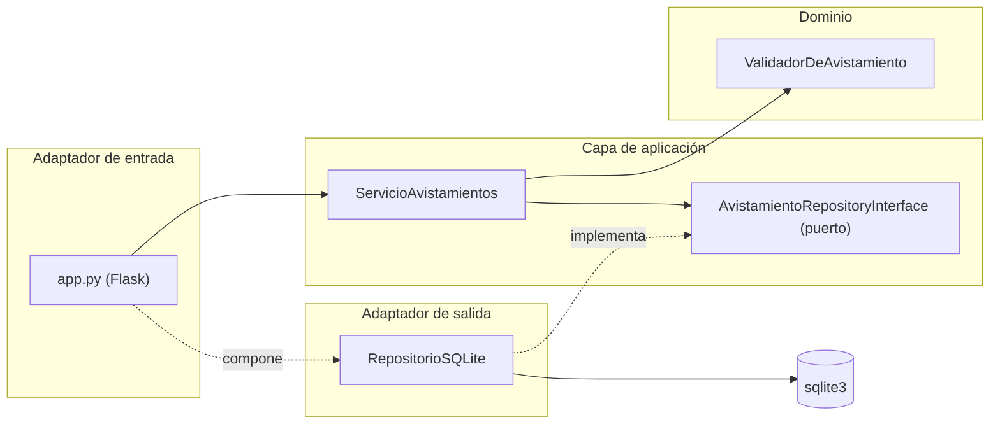

# Taller: Clean Architecture y arquitectura hexagonal

Ingeniería de Software 2 (ISW-2). Trabajo individual sobre la API de avistamientos de aves.

**Repositorio:** https://github.com/yonnatan-sys/isw2-api-avistamientos/tree/clean-architecture
**Rama:** `clean-architecture`

---

## Parte 1. Investigación

### 1. Problema de Cockburn, puertos, adaptadores y simetría

Alistair Cockburn notó que en su época las aplicaciones sufrían de un acoplamiento rígido donde la lógica de negocio se encontraba mezclada con la interfaz gráfica y las bases de datos relacionales, lo que impedía probar el software de forma automatizada sin depender de infraestructura externa (Cockburn, 2005). Para solucionar esto, propone la arquitectura hexagonal, donde un puerto es una interfaz agnóstica que define un punto de entrada o salida para que la aplicación interactúe con el exterior, mientras que un adaptador es el componente tecnológico concreto (como un controlador HTTP o un driver de base de datos) que traduce las llamadas externas al formato que el núcleo entiende (Cockburn, 2005).

Dice que hay una simetría entre el lado del usuario y el lado de la base de datos porque, desde la perspectiva de la aplicación, el usuario, las pruebas automatizadas y la base de datos son actores externos que se conectan al núcleo mediante puertos, y el núcleo no debería distinguir entre ellos (Cockburn, 2005).

### 2. Círculos concéntricos y la regla de dependencia

Clean Architecture organiza el software en círculos concéntricos de abstracción creciente: en el centro se ubican las Entidades (reglas de negocio empresariales), seguidas por los Casos de Uso (reglas de negocio de la aplicación), luego los Adaptadores de Interfaces (controladores y pasarelas), y en la capa más externa los Frameworks y Drivers (bases de datos, servidores web y herramientas) (Martin, 2012).

La regla de dependencia establece que las dependencias del código fuente solo pueden apuntar hacia el centro, es decir, hacia las políticas de más alto nivel (Martin, 2012). Según Martin, el código de un círculo exterior puede conocer al interior, pero no al revés, lo que prohíbe estrictamente que las capas internas mencionen, importen o dependan de clases, funciones o estructuras declaradas en un círculo exterior (Martin, 2012). En mi API, el caso de uso `ServicioAvistamientos` orquesta la validación que vive en `dominio/validador.py`, y no importa nada de Flask ni de SQLite.

### 3. Inversión de dependencias para la persistencia

Clean Architecture resuelve esta contradicción aplicando el Principio de Inversión de Dependencias (DIP, la letra *D* de los principios SOLID) (Martin, 2012). En el código fuente, la inversión ocurre porque la infraestructura importa la interfaz definida en el núcleo, haciendo que la dependencia apunte siempre hacia adentro; luego, en tiempo de ejecución, la implementación concreta se inyecta polimórficamente (Martin, 2012).

En mi código, `ServicioAvistamientos` recibe por parámetro un objeto que cumple `AvistamientoRepositoryInterface`, definida en `aplicacion/puertos.py`, y llama a `self._repo.crear(...)` sin conocer si detrás hay SQLite. `RepositorioSQLite`, en `infraestructura/repositorio_sqlite.py`, implementa esa misma interfaz con sus consultas SQL, y `app.py` la inyecta al construir el servicio. Así, el caso de uso no importa `sqlite3` en ningún momento.

### 4. Comparación: hexagonal, cebolla y Clean Architecture

Las tres arquitecturas comparten el mismo propósito fundamental: colocar la lógica de negocio en el centro, aislarla de los frameworks y bases de datos externos, y maximizar la testabilidad del software (Cockburn, 2005; Martin, 2012; Palermo, 2008).

Lo que cambia de una a otra no es solo el vocabulario, sino la estructura y formalización de las capas (Palermo, 2008):

- **Hexagonal (Cockburn, 2005):** no define un número estricto de capas concéntricas; se centra en la simetría de puertos y adaptadores alrededor de la aplicación para manejar entradas y salidas.
- **Cebolla (Palermo, 2008):** define explícitamente capas concéntricas con el modelo de dominio en el centro, rodeado por servicios de dominio y servicios de aplicación, ubicando las interfaces de repositorio directamente dentro de la capa de dominio.
- **Clean Architecture (Martin, 2012):** unifica los conceptos anteriores estipulando cuatro círculos concéntricos universales (Entidades, Casos de Uso, Adaptadores de Interfaces y Frameworks) regidos por una regla estricta de dependencia unidireccional hacia el centro.

### 5. ¿Se justifica Clean Architecture en una API pequeña?

Para una API de avistamientos pequeña, aplicar Clean Architecture tiene un costo evidente en complejidad estructural y código repetido (*boilerplate*): pasé de un `app.py` con toda la lógica a cuatro archivos nuevos (el puerto, el caso de uso, las excepciones y el adaptador SQLite), tres `__init__.py` y el `validador.py` movido a `dominio/`. La entidad `Avistamiento` no se volvió una clase: sigue siendo un diccionario, lo que es una simplificación. Un costo verificable es que las pruebas de integración del endpoint POST siguen necesitando el cliente de Flask, así que no todas las pruebas quedan puras.

El beneficio concreto va más allá de controlar el tiempo, que ya se lograba con un `RelojFijo` en el taller previo: el caso de uso ignora por completo la existencia de Flask y de SQLite, de modo que cambiar de framework web o de motor de base de datos afectaría únicamente al adaptador correspondiente sin tocar las reglas de negocio (Martin, 2012). Tomando una posición, aunque el volumen inicial de archivos y código aumenta, sí se justifica porque aporta una mantenibilidad estructural sólida y protege la lógica del dominio frente a cambios tecnológicos futuros.

### Referencias

Cockburn, A. (2005). *Hexagonal architecture*. https://alistair.cockburn.us/hexagonal-architecture/

Martin, R. C. (2012). *The Clean Architecture*. https://blog.cleancoder.com/uncle-bob/2012/08/13/the-clean-architecture.html

Palermo, J. (2008). *The Onion Architecture: part 1*. https://jeffreypalermo.com/2008/07/the-onion-architecture-part-1/

---

## Parte 2. Aplicación

### 2.1 Arquitectura elegida

Elegí la **arquitectura hexagonal** (puertos y adaptadores). El dominio contiene la regla de validación y no conoce Flask ni SQLite. La capa de aplicación contiene el caso de uso y el puerto del repositorio, y solo depende del dominio. La infraestructura implementa el puerto con SQLite. `app.py` es el adaptador de entrada HTTP y, además, el punto de composición donde se decide qué adaptador usar.

### 2.2 Estructura de carpetas

```
app.py                              Adaptador de entrada (Flask) y composición
aplicacion/
  puertos.py                        Puerto: AvistamientoRepositoryInterface
  servicio_avistamientos.py         Caso de uso: ServicioAvistamientos
  excepciones.py                    AvistamientoNoEncontrado, DatosInvalidos
dominio/
  validador.py                      Regla de validación y interfaz Reloj
infraestructura/
  repositorio_sqlite.py             Adaptador de salida: RepositorioSQLite
test/
  test_app.py                       Pruebas de integración (HTTP)
  test_validador.py                 Pruebas unitarias del validador
docs/
  justificacion-pruebas.md
  arquitectura-clean.md
```

### 2.3 Dirección de las dependencias



| Archivo | Importa del proyecto | Capa |
|---|---|---|
| `app.py` | `aplicacion.excepciones`, `aplicacion.servicio_avistamientos`, `dominio.validador`, `infraestructura.repositorio_sqlite` | Adaptador de entrada y composición |
| `aplicacion/servicio_avistamientos.py` | `aplicacion.excepciones`, `dominio.validador` | Aplicación |
| `aplicacion/puertos.py` | ninguno | Aplicación (puerto) |
| `aplicacion/excepciones.py` | ninguno | Aplicación |
| `dominio/validador.py` | ninguno | Dominio |
| `infraestructura/repositorio_sqlite.py` | `aplicacion.puertos`, `dominio.validador` (y `sqlite3`) | Adaptador de salida |


### 2.4 Commits

| Commit | Mensaje |
|---|---|
| `90a5e48` | Evidencia de pruebas y API antes del refactor |
| `0013f36` | Mover la regla de validación a la carpeta dominio |
| `8e25f16` | Definir puerto del repositorio y adaptador SQLite |
| `ff6537f` | Caso de uso y controlador delgado sobre el puerto |
| `bb285cb` | Evidencia de pruebas y API después del refactor |

### 2.5 Evidencia de funcionamiento y cobertura

**Pruebas**

| Momento | Resultado |
|---|---|
| Antes | 30 passed in 0.60s |
| Después | 30 passed in 0.61s |

**Cobertura antes** (`pytest --cov=app --cov=validador --cov-branch --cov-report=term-missing`)

```
Name           Stmts   Miss Branch BrPart  Cover   Missing
app.py            78      1     16      1    98%   112
validador.py      38      1     10      0    98%   11
TOTAL            116      2     26      1    98%
```

**Cobertura después** (`pytest --cov=app --cov=dominio --cov=aplicacion --cov=infraestructura --cov-branch --cov-report=term-missing`)

```
Name                                    Stmts   Miss Branch BrPart  Cover   Missing
aplicacion\__init__.py                      0      0      0      0   100%
aplicacion\excepciones.py                   6      0      0      0   100%
aplicacion\puertos.py                       2      0      0      0   100%
aplicacion\servicio_avistamientos.py       32      0      4      0   100%
app.py                                     45      1      2      1    96%   67
dominio\__init__.py                         0      0      0      0   100%
dominio\validador.py                       38      1     10      0    98%   11
infraestructura\__init__.py                 0      0      0      0   100%
infraestructura\repositorio_sqlite.py      42      0      0      0   100%
TOTAL                                     165      2     16      1    98%
```

**Lectura de la cobertura.** El total se mantuvo en 98%, y las líneas sin cubrir son las mismas que antes: el bloque `if __name__ == "__main__"` de `app.py` (línea 67 después, línea 112 antes) y el `raise NotImplementedError` de la interfaz `Reloj` (línea 11 de `dominio/validador.py`). Ninguna de las dos tiene lógica de negocio: la primera solo arranca el servidor y la segunda es el cuerpo de una interfaz abstracta que no debe ejecutarse directamente. Los archivos medidos cambiaron porque la estructura cambió. Las capas nuevas (`aplicacion` e `infraestructura`) quedaron en 100% gracias a las pruebas de integración.

**Comparación de la API.** Antes y después del refactor se hicieron las mismas peticiones (listar, resumen, obtener por id y crear) con `curl`, y se compararon con `fc`. Las respuestas son idénticas, salvo la línea `Date:`, que cambia en cada petición. Los códigos de estado coinciden:

```
antes_listar.txt    / despues_listar.txt:    HTTP/1.1 200 OK
antes_resumen.txt   / despues_resumen.txt:   HTTP/1.1 200 OK
antes_obtener.txt   / despues_obtener.txt:   HTTP/1.1 200 OK
antes_crear.txt     / despues_crear.txt:     HTTP/1.1 201 CREATED
```

### 2.6 Lo más difícil de separar

Lo más difícil fue decidir dónde vivía cada regla que antes estaba junta en el controlador.

- **Dónde va el `strip()`.** Lo puse en `ServicioAvistamientos._normalizar`, no en el adaptador. Es una regla de negocio (los espacios al inicio y al final no cuentan), y el adaptador SQLite solo guarda datos ya normalizados.
- **El orden 404 antes que 400 en `PUT`.** El controlador original respondía 404 si el id no existía antes de validar el cuerpo. Para conservar ese comportamiento, `actualizar` llama primero a `obtener` y después a `_validar`. Si el orden cambiaba, las respuestas HTTP también cambiaban, y la comparación con `fc` lo habría mostrado.
- **Errores de negocio sin códigos HTTP.** El servicio lanza `AvistamientoNoEncontrado` y `DatosInvalidos`. Es `app.py` quien las traduce a 404 y 400 con `errorhandler`, así el caso de uso no conoce HTTP.
- **Conexiones SQLite.** Al mover el SQL al adaptador, cada método abre y cierra su propia conexión. Tuve que usar `closing(...)` para que no quedaran conexiones abiertas (los avisos `ResourceWarning` de las pruebas).

### 2.7 Limitaciones

- La entidad `Avistamiento` no es una clase: los datos viajan como diccionarios. Una clase sería el siguiente paso si la API creciera.
- `RepositorioSQLite` abre una conexión por operación. Es simple y correcto para esta API, pero no escala como un pool de conexiones.
- Las pruebas de integración usan el cliente de Flask, así que no son puras. Es el costo que señalé en la Parte 1.
- `app.py` importa `infraestructura` para componer la aplicación. Es la única excepción a la regla de dependencia, y está en el punto de composición.
